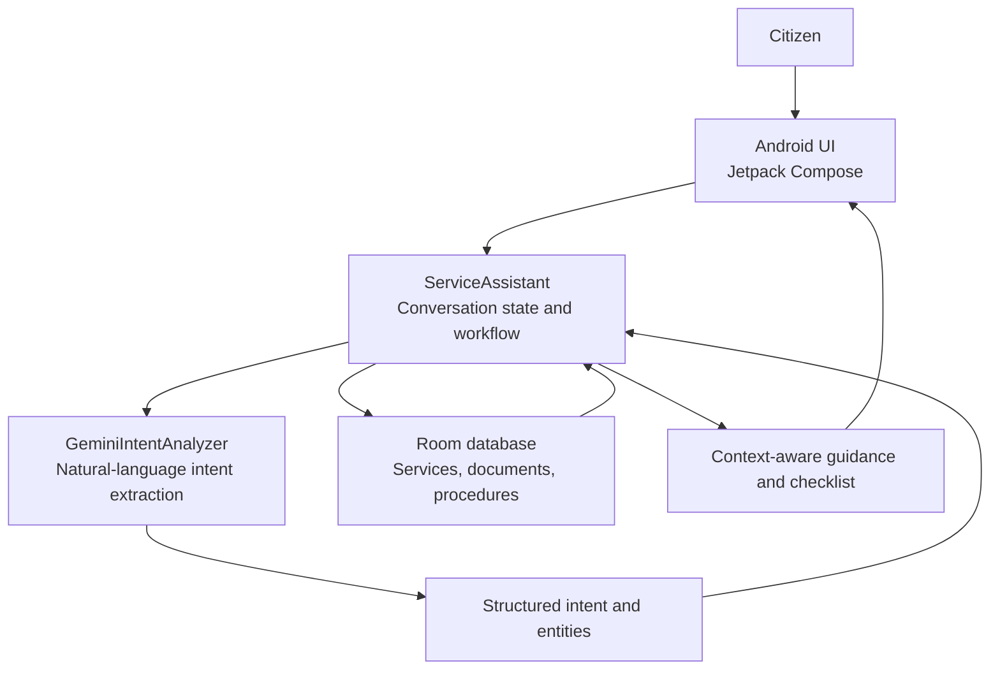
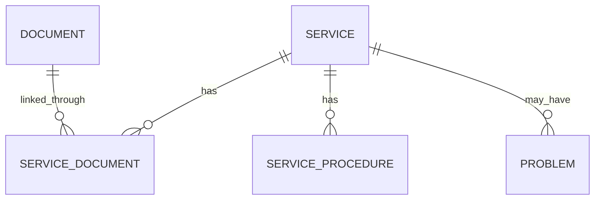

# AI Service Guide

An Android-based citizen-service assistance application that helps people understand public-service procedures and prepare the documents they may need before visiting an office.

The app combines Gemini-powered natural-language intent understanding with a local Room database that stores the service and document information used to prepare guidance.

> **Design principle:** AI interprets the request; the application's local data is the source used for service and document facts.

## Project at a glance

- **Platform:** Android
- **Language:** Kotlin
- **UI:** Jetpack Compose
- **Local data:** Room
- **AI integration:** Gemini API
- **Interaction:** Text and voice input
- **Languages:** English, Kannada, and Kannada-English mixed input

## Problem

People may make repeated visits to public-service offices because they are unsure which documents are required, how to apply, where to obtain a missing document, or what to do when an application encounters a problem.

AI Service Guide aims to make this preparation easier through a conversational interface and locally stored service information.

## Features

- Natural-language service identification.
- Guidance about required documents and application procedures.
- Missing-document follow-up guidance.
- Context-aware follow-up questions.
- Preparation checklist.
- English, Kannada, and Kannada-English mixed-language input.
- Voice input.
- Local database-backed service and document information.

The information available to a user depends on the service records included in the application's database. The app should not be treated as an official government portal or as a substitute for checking the relevant department's current requirements.

## Example interaction

1. A user asks: `I need an income certificate.`
2. The app interprets the request and identifies the relevant service.
3. The user asks which documents are required.
4. The app retrieves the corresponding information from its local database.
5. The user can ask follow-up questions about a missing document or request a checklist.

Kannada and mixed-language examples are included in the application's manual test scenarios.

## Architecture



### Main components

| Component | Responsibility |
|---|---|
| `MainActivity.kt` | Main Android interface and interaction entry point |
| `ServiceAssistant.kt` | Conversation workflow, state, service/document actions, and follow-ups |
| `ConversationModels.kt` | Shared conversation models and result/state types |
| `GeminiIntentAnalyzer.kt` | Converts natural-language messages into structured intent information |
| Room entities and DAOs | Represent and retrieve service, document, relationship, problem, and procedure data |
| `DatabaseSeeder.kt` | Supplies initial local service/document records |

### Data relationship (conceptual)



This is a conceptual view of the relationships described by the project. Refer to the Room entity definitions for the exact implemented schema.

## Technology stack

| Technology | Role |
|---|---|
| Kotlin | Application language |
| Jetpack Compose | Android UI |
| Room | Local structured database |
| Gemini API | Natural-language intent understanding |
| Kotlin Coroutines | Asynchronous operations |
| Gradle Kotlin DSL | Build configuration |
| Android voice input | Voice interaction |
| Git and GitHub | Version control and source hosting |

## Requirements

- Android Studio with support for the Android Gradle Plugin version configured in this repository.
- Android SDK Platform 37 (the project uses compile SDK 37).
- Android device or emulator running Android 8.1 / API 27 or later (the configured minimum SDK is 27).
- JDK compatible with the configured Gradle 9.5 wrapper and Android Gradle Plugin.
- Internet access to download dependencies and use Gemini-powered intent understanding.
- A Gemini API key for AI-assisted functionality.

The repository includes the Gradle Wrapper. Use `gradlew.bat` on Windows or `./gradlew` on macOS/Linux rather than installing a separate Gradle distribution.

## Setup and run

### 1. Clone the repository

```bash
git clone https://github.com/niranjanhm21/AIServiceGuide.git
cd AIServiceGuide
```

### 2. Open and sync

1. Open the cloned folder in Android Studio.
2. Allow the IDE to sync the Gradle project and download dependencies.
3. Install Android SDK Platform 37 if Android Studio prompts for it.
4. Select an emulator or connect an Android device with USB debugging enabled.

### 3. Configure Gemini

The app module reads a `GEMINI_API_KEY` property from the root-level `local.properties` file and places it in generated BuildConfig.

Add this line to the root-level `local.properties` file on your machine:

```properties
GEMINI_API_KEY=YOUR_GEMINI_API_KEY
```

If the file already contains an Android SDK path, keep that line and add the key on a separate line. Do not replace the existing SDK configuration.

The repository's `.gitignore` excludes `local.properties`. Never commit a real API key, token, password, signing key, or other secret.

**Security note:** A key compiled into an Android application can be extracted from the distributed APK. Local properties prevent accidental source-control commits; they do not make a client-side key secret from app users. For a production release, put Gemini access behind a trusted backend and apply appropriate API restrictions, quotas, and monitoring.

### 4. Build

On Windows:

```powershell
.\gradlew.bat assembleDebug
```

On macOS/Linux:

```bash
./gradlew assembleDebug
```

You can also use **Build → Make Project** in Android Studio.

### 5. Run

Choose an emulator or connected device and press **Run** in Android Studio. The debug APK is normally generated under:

```text
app/build/outputs/apk/debug/
```

## Try the app

Use these as manual test prompts, depending on the service records available in the local database:

**English**
- `I need an income certificate.`
- `What documents are required?`
- `How do I apply?`
- `I don't have address proof.`
- `How do I get it?`
- `Show my checklist.`

**Kannada**
- `ಆದಾಯ ಪ್ರಮಾಣ ಪತ್ರ ಬೇಕು`
- `ಅಗತ್ಯ ದಾಖಲೆಗಳು ಯಾವುವು?`
- `ಅರ್ಜಿ ಹೇಗೆ ಸಲ್ಲಿಸಬೇಕು?`
- `ನನ್ನ ಬಳಿ ವಿಳಾಸದ ಪುರಾವೆ ಇಲ್ಲ`

**Kannada-English mixed**
- `income certificate ಗೆ ಯಾವ documents ಬೇಕು?`
- `address proof ಇಲ್ಲ, ಏನು ಮಾಡಬೇಕು?`

These are suggested manual checks, not a claim that every phrasing or service has been formally validated.

## Testing

The repository includes JUnit and AndroidX test dependencies. Run the available test tasks from the project root:

```powershell
.\gradlew.bat test
.\gradlew.bat connectedAndroidTest
```

The connected test task requires a running emulator or connected test device. Add project-specific test cases as the conversation and database features evolve.

## Screenshots and demo

Capture real screenshots from the running application and add them under `docs/screenshots/`. See [the screenshot capture checklist](docs/SCREENSHOTS.md) for recommended views and filenames. Do not use mockups as evidence of implemented functionality.

## Security and responsible use

- Keep API keys and other credentials out of source control.
- The local Room database is the source used for service/document facts; Gemini is used for language understanding.
- Verify service requirements with the relevant official department because public-service rules can change.
- Do not present the app as an official government service unless an authorized integration exists.
- Before public distribution, review API-key handling, privacy, voice-input permissions, data retention, and applicable platform requirements.

## Current status and limitations

The app depends on the service and document records packaged in its local database. The completeness and currency of those records determine the breadth of guidance it can provide. A production deployment would require stronger backend-based secret handling, maintained official data sources, and broader device/language testing.

## Future improvements

- Expand and maintain verified service data.
- Add automated tests for intent-to-database workflows.
- Improve error handling for network/API failures.
- Add a trusted backend for Gemini requests.
- Capture and publish a demonstration video.
- Evaluate accessibility and usability with representative users.

## License

No license file was identified during this documentation review. Unless a license is added to the repository, reuse and redistribution permissions are not explicitly granted.
