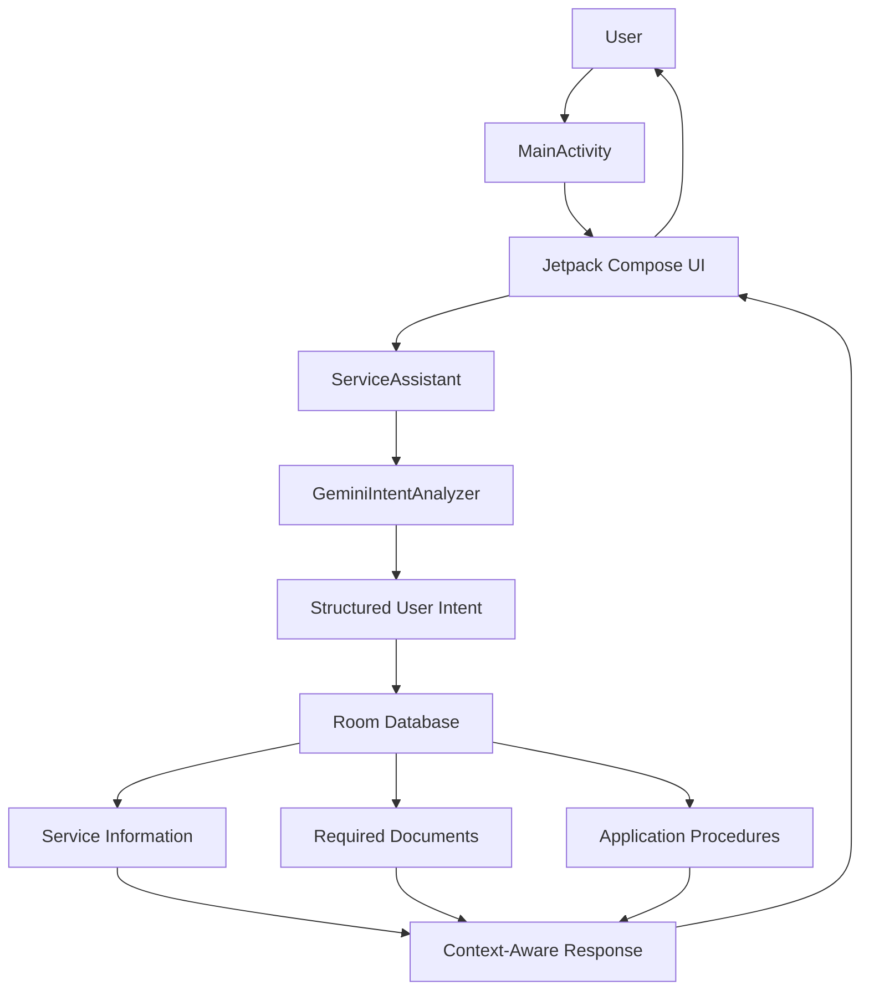
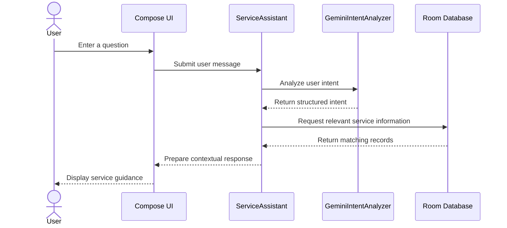

# AIServiceGuide — System Architecture

## 1. Overview

AIServiceGuide is an Android application designed to help citizens understand government services, required documents, eligibility information, and application procedures.

The application combines a conversational interface, AI-based intent understanding, and a structured local database to provide relevant service guidance.

## 2. Technology Stack

| Component | Technology |
|---|---|
| Programming Language | Kotlin |
| UI Framework | Jetpack Compose |
| Local Database | Room |
| AI Integration | Google Gemini API |
| Database Queries | Room DAO |
| Build System | Gradle |
| Development Environment | Android Studio |

## 3. High-Level Architecture

The application follows a layered architecture:

## 4. Main Components

### 4.1 User Interface Layer
- Built using Jetpack Compose.
- Provides the conversational interface.
- Accepts user questions and displays service guidance.
- Displays relevant information in a user-friendly format.

### 4.2 Conversation Management Layer
- Managed by `ServiceAssistant`.
- Coordinates the conversation workflow.
- Connects user input, intent analysis, database retrieval, and response generation.

### 4.3 AI Intent Analysis Layer
- Implemented through `GeminiIntentAnalyzer`.
- Uses the Gemini API to understand the user's question.
- Identifies the user's intended government service or information requirement.
- Helps convert natural-language questions into structured intent.

### 4.4 Database Layer
- Uses Room for local data storage.
- Stores structured government service information.
- Includes service details, documents, and application procedures.
- Uses entities and DAOs to organize and retrieve information.

### 4.5 Database Seeding
- `DatabaseSeeder` is responsible for inserting the initial service information into the local database.
- Provides structured data for the application to retrieve.

## 5. Request Processing Workflow

## 6. Data Flow

1. The user enters a question in the application.
2. The UI forwards the question to the conversation management component.
3. The intent analyzer interprets the question.
4. The structured intent helps identify relevant information.
5. The application retrieves matching records from the Room database.
6. The conversation component prepares a contextual response.
7. The UI displays the response to the user.

## 7. Important Design Considerations

- **Separation of responsibilities:** UI, conversation management, AI intent analysis, and database operations have separate responsibilities.
- **Structured information:** Government service information is stored in a structured database.
- **Context-aware guidance:** User intent helps retrieve relevant service information.
- **AI as an interpretation layer:** AI assists with understanding user questions; it should not be treated as the authoritative source of government rules or eligibility.
- **Data reliability:** Service details should be verified against official government sources and updated when requirements change.

## 8. Security Considerations

The Gemini API key must not be committed to the public repository.

The development configuration uses `local.properties` to keep the key outside version control. However, an API key included in a distributed Android application can potentially be extracted from the APK.

For production use, a trusted backend with appropriate API restrictions is recommended.

## 9. Future Improvements

- Integration with verified government service APIs.
- Improved multilingual support.
- More comprehensive service information.
- Better error handling and offline support.
- Backend-based secure AI integration.
- Automated testing of service information retrieval.

---

**Note:** This document describes the intended high-level architecture. Implementation details may evolve as the application develops.
